


<!-- live from last.fm through a cloudflare worker, source in nowplaying/ -->

 

&nbsp;&nbsp;&nbsp;
&nbsp;&nbsp;&nbsp;
&nbsp;&nbsp;&nbsp;
&nbsp;&nbsp;&nbsp;
&nbsp;&nbsp;&nbsp;
&nbsp;&nbsp;&nbsp;
&nbsp;&nbsp;&nbsp;
&nbsp;&nbsp;&nbsp;
&nbsp;&nbsp;&nbsp;
&nbsp;&nbsp;&nbsp;
&nbsp;&nbsp;&nbsp;

<a href="https://thecatart.com">thecatart.com</a>

### ~/stack

<!-- stack:start (generated by scripts/stack.py) -->

<b>languages</b>

 

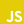&nbsp;&nbsp;
&nbsp;&nbsp;
&nbsp;&nbsp;
&nbsp;&nbsp;
&nbsp;&nbsp;
&nbsp;&nbsp;
&nbsp;&nbsp;
&nbsp;&nbsp;
&nbsp;&nbsp;
&nbsp;&nbsp;
&nbsp;&nbsp;
&nbsp;&nbsp;
&nbsp;&nbsp;
&nbsp;&nbsp;

<b>web, apps & games</b>

 

&nbsp;&nbsp;
&nbsp;&nbsp;
&nbsp;&nbsp;
&nbsp;&nbsp;
&nbsp;&nbsp;
&nbsp;&nbsp;
&nbsp;&nbsp;
&nbsp;&nbsp;
&nbsp;&nbsp;

<b>backend & data</b>

 

&nbsp;&nbsp;
&nbsp;&nbsp;
&nbsp;&nbsp;
&nbsp;&nbsp;
&nbsp;&nbsp;
&nbsp;&nbsp;
&nbsp;&nbsp;
&nbsp;&nbsp;
&nbsp;&nbsp;
&nbsp;&nbsp;
&nbsp;&nbsp;

<b>selfhosting & infra</b>

 

&nbsp;&nbsp;
&nbsp;&nbsp;
&nbsp;&nbsp;
&nbsp;&nbsp;
&nbsp;&nbsp;
&nbsp;&nbsp;
&nbsp;&nbsp;
&nbsp;&nbsp;
&nbsp;&nbsp;
&nbsp;&nbsp;
&nbsp;&nbsp;
&nbsp;&nbsp;
&nbsp;&nbsp;
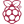

<b>security</b>

 

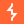&nbsp;&nbsp;
&nbsp;&nbsp;
&nbsp;&nbsp;
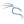&nbsp;&nbsp;
&nbsp;&nbsp;
&nbsp;&nbsp;
&nbsp;&nbsp;

<b>design & video</b>

 

&nbsp;&nbsp;
&nbsp;&nbsp;
&nbsp;&nbsp;
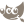&nbsp;&nbsp;
&nbsp;&nbsp;
&nbsp;&nbsp;
&nbsp;&nbsp;
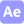&nbsp;&nbsp;
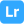&nbsp;&nbsp;
&nbsp;&nbsp;

<!-- stack:end -->

### ~/projects

most of this lives in private repos, so no links. ask if you're curious.

- **kairos**: self-hosted time and project tracker &nbsp;`react` `express` `mysql`
- **privacy-dashboard**: shows live where devices phone home to, built for the kärntner linux tag 2026 in villach &nbsp;`react` `d3` `python`
- **serpantinum extras**: face unlock and other extras for my hyprland rice &nbsp;`qml` `lua` `python`
- **[tca-station](https://github.com/TheCatArt/TCA-Station)**: management page for my radio station &nbsp;`fastapi`

one of the it-admins at [node-K](https://node-k.at). if the wifi's down, it was dns.

<a href="https://node-k.at"></a>

### ~/stats


<picture>
  <source media="(prefers-color-scheme: dark)" srcset="https://raw.githubusercontent.com/TheCatArt/TheCatArt/output/snake-dark.svg">
  
</picture>

also hanging around at [minergames](https://github.com/MinerGamesNET) and [alpsec](https://github.com/AlpSecAustria)


it's a reference. iykyk.

